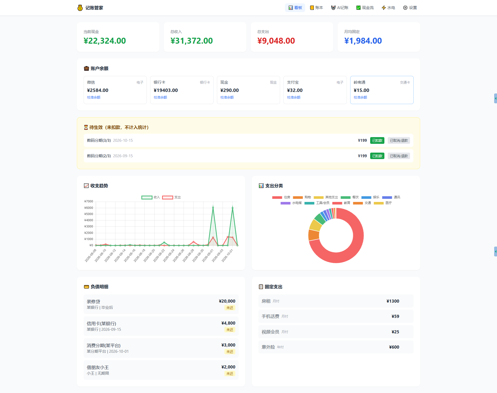
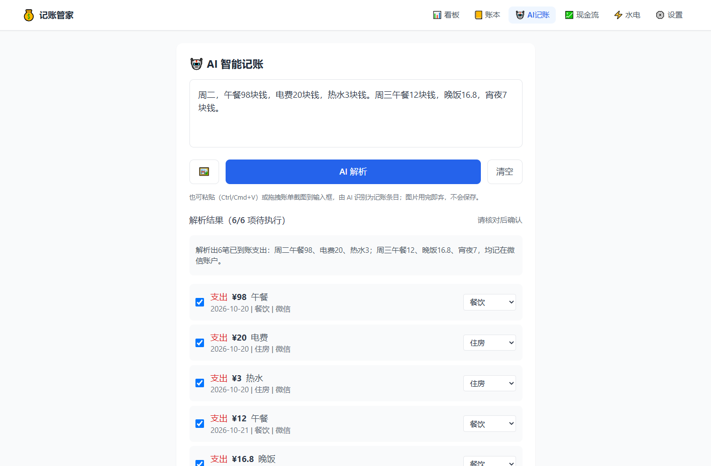
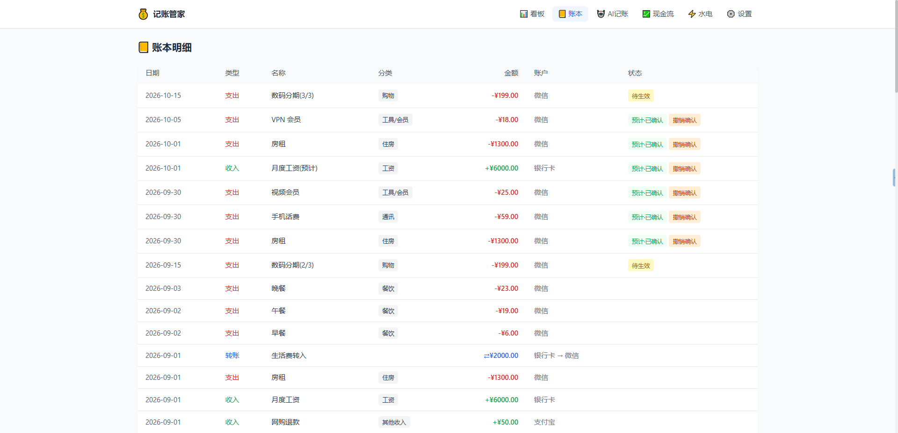
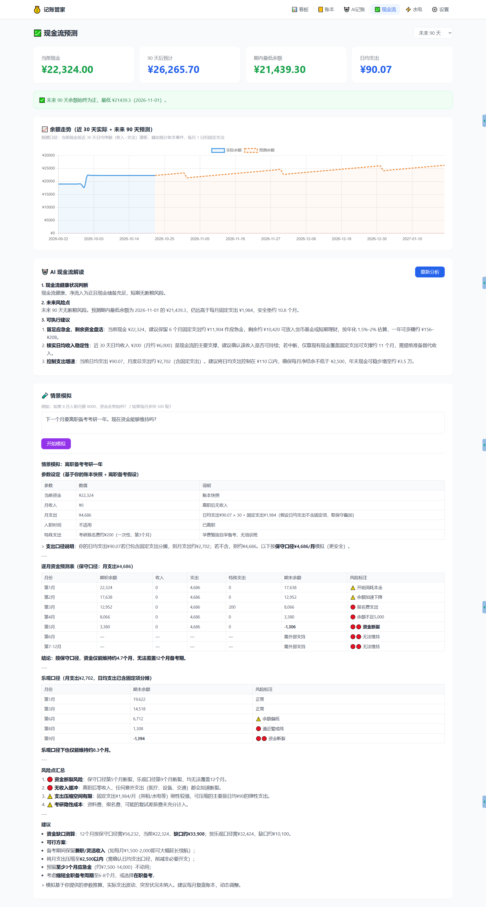
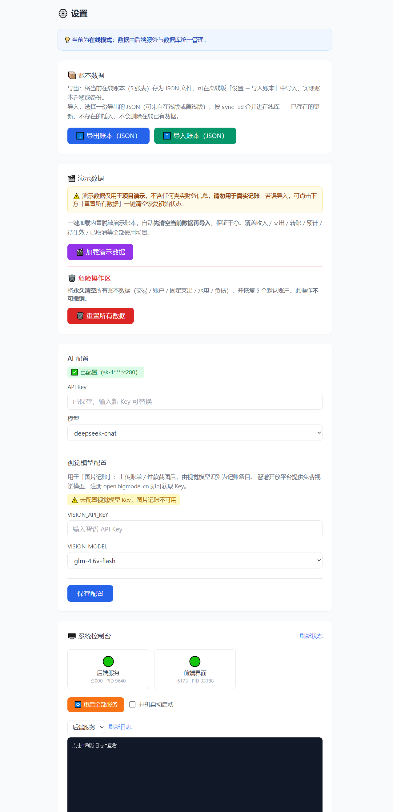
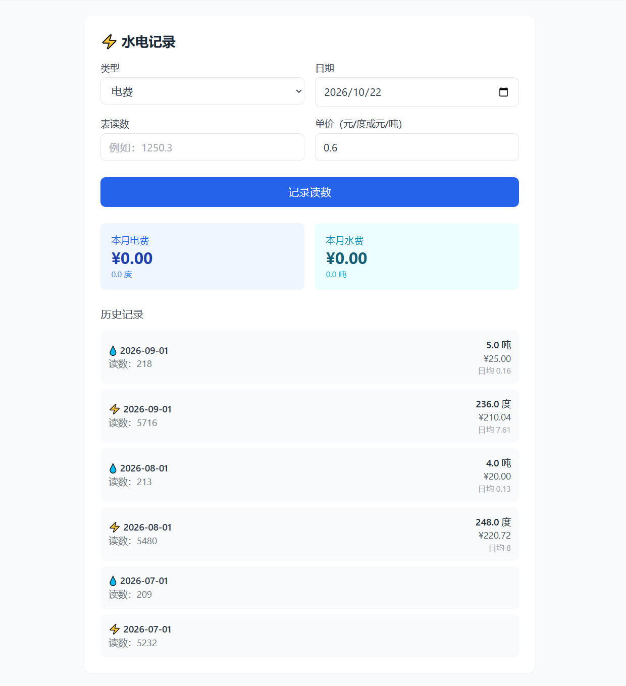

# 💰 Bill-Bookkeeper 记账管家

> 个人财务记账系统：AI 智能识别 + 多账户体系 + Web 可视化看板 + 现金流预测

    

**🌐 在线展示站（含完整功能介绍与界面演示）：<https://minipluto.cn/bill-bookkeeper/>**



一句话记一整天的账：AI 自动拆分收支、识别分类与账户；微信 / 银行卡 / 现金等多账户余额对得上真实钱包；30 / 90 / 180 天现金流预测提前告诉你"哪个月会没钱"。

---

## 界面一览

<p align="center">
  
  
</p>
<p align="center">
  
</p>
<p align="center">
  
  
</p>
<p align="center">
  
</p>

> 以上页面均基于内置**脱敏演示数据**（设置页可一键加载）。

---

## 快速开始

| 步骤 | 操作 | 说明 |
|------|------|------|
| 1️⃣ | 运行 `scripts/install.bat` | 安装所有依赖（只需一次） |
| 2️⃣ | 双击 `start.bat` | 启动！浏览器打开 http://localhost:5173 |
| 3️⃣ | 打开「设置」页 | 填入 DeepSeek API Key，即可用 AI |

**详细图文教程** → [INSTALL.md](INSTALL.md)

---

## 功能亮点

| 功能 | 说明 |
|------|------|
| 🤖 **AI 智能记账** | 自然语言一句话记一整天的账，自动识别收支、分类；支持图片 / 粘贴账单解析 |
| 🔀 **账户体系** | 微信/银行卡/现金/交通卡…分账户余额，充值=转账不双计 |
| 🎯 **余额校准** | 报一次真实余额即可锚定，系统永远对得上你的钱包 |
| 📤 **账本导出/导入** | 在线版「设置」一键导出 JSON；可再导入合并（sync_id 去重），离线↔在线双向同步 |
| ⏳ **待生效** | 先用后付/未扣款单独挂起，确认收货才计入统计 |
| ✅ **预计确认/取消** | 固定支出「预计」行可确认（计入现金）或取消（停后续预测）；误确认可一键撤销 |
| 🧠 **AI 操作引擎** | 说"微信剩2000"自动校准，说"酷狗不每月扣了"自动取消固定支出 |
| 📊 **Web 看板** | 收支趋势、分类饼图、分账户余额、固定支出管理 |
| 💹 **现金流预测** | 30/90/180 天余额预测曲线 + AI 风险解读 + 情景模拟 |
| ⚡ **水电记录** | 读数录入，按类型自动算用量和日均 |
| 🖥️ **系统控制台** | 设置页在线看状态/重启服务/开关开机自启/查日志 |

---

## 日常操作

| 想做什么 | 怎么做 |
|---------|--------|
| 启动 | 双击 `start.bat` |
| 关闭 | 双击 `stop.bat` |
| 查看服务状态 / 重启 / 日志 | 网页「设置 → 系统控制台」 |
| 开关开机自启动 | 网页「设置 → 系统控制台」 |
| 修改 AI 配置 | 网页「设置」页（写入 `.env`） |
| 校准账户余额 | 看板「账户余额」卡片 → 校准余额（弹对话框输入真实余额） |
| 导出/导入账本（JSON） | 网页「设置 → 账本数据」→ 导出 / 导入 |
| 加载演示数据 | 网页「设置 → 演示数据」→ 一键加载 / 重置 |
| 导入 Excel 账本 | `scripts/migrate.bat`（需系统 Python + `pip install openpyxl`） |
| 安装/诊断/卸载等辅助脚本 | `scripts/` 目录 |

---

## 项目结构

```
bill-bookkeeper/
├── 📄 start.bat            ← 启动服务
├── 📄 stop.bat             ← 关闭服务
├── 📄 .env                 ← 敏感配置（不入库，模板见 .env.example）
│
├── 📁 packages/
│   ├── 📁 server/          ← 后端服务 (Node Express, :3000，含进程内 AI)
│   │   └── 📁 src/ai/      ← AI 能力（进程内，无需独立服务）
│   └── 📁 frontend/        ← 前端界面 (Vue3, :5173)
│
├── 📁 scripts/             ← 安装/迁移/诊断等辅助脚本
│
├── 📁 assets/screenshots/  ← README 界面截图
│
└── 📁 data/
    ├── 📄 ledger.db        ← 你的数据 (SQLite)
    └── 📁 logs/            ← 运行日志
```

## 端口与多项目共存

| 服务 | bill-bookkeeper | snowball-daily |
|------|----------------|----------------|
| 后端 | :3000 | :3100 |
| 前端 | :5173 | :5273 |

## 技术栈

- **AI**: 进程内实现（`packages/server/src/ai/`）+ 智谱 GLM / DeepSeek API，无需独立 Python 服务
- **后端**: Node.js (≥22.5) + Express + **node:sqlite**（内置 SQLite，无原生模块）
- **前端**: Vue3 + Vite + TailwindCSS + Chart.js + Pinia
- **双模式**: 在线 fetch 版（Node 后端 + SQLite）/ 离线单文件版（纯浏览器 IndexedDB，无需服务器，`file://` 直接打开）
- **数据**: SQLite（`data/ledger.db`）

---

## 需要帮助？

1. 网页「设置 → 系统控制台」查看服务状态和日志
2. 日志文件：`data/logs/` 目录
3. 阅读 [INSTALL.md](INSTALL.md) 详细安装指南
